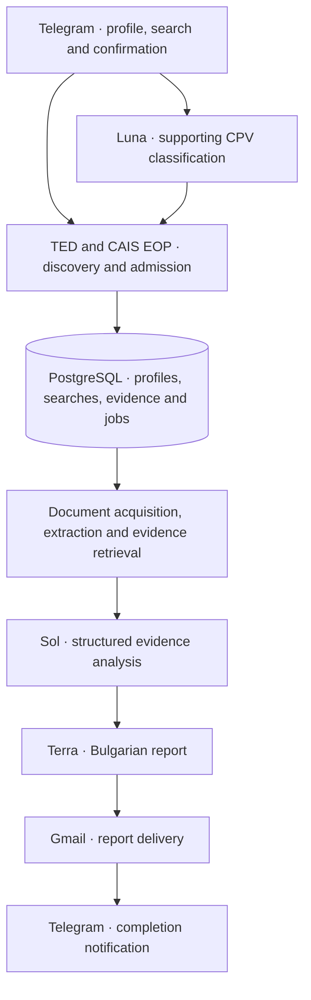

# AI Tender Intelligence

## Beta Status, Architecture & Engineering Decisions

**AI Tender Intelligence** is a deployed, end-to-end Bulgarian public procurement analysis Beta built around **Retrieval-Augmented Generation (RAG)**. Users discover tenders through paginated Telegram searches, select an opportunity, and independently authorize an AI analysis. The system extracts procurement documents, retrieves source-grounded evidence, and delivers a structured Bulgarian report by email.

The modular workflow integrates **TED and CAIS EOP APIs, PostgreSQL, document processing, RAG, multiple OpenAI models, Gmail, and Telegram**, deployed with Docker on Railway.

**Key engineering capabilities**

- **RAG & evidence traceability:** Bounded document extraction, deterministic retrieval, source references, provenance tracking, and evidence-grounded AI analysis.
- **Multi-model AI orchestration:** Luna handles CPV classification, Sol analyzes procurement evidence, and Terra synthesizes the final report through separate OpenAI API calls.
- **Reliability & data integrity:** PostgreSQL transactions, idempotency, ownership isolation, independent analysis requests, explicit user confirmations, and durable execution/delivery records.
- **Controlled execution:** Paginated tender discovery, bounded processing, API spending controls, and safeguards against duplicate paid operations. Uncertain AI or email outcomes are not automatically retried.
- **Deployment & verification:** Successfully deployed on Railway and validated through automated testing and a live end-to-end analysis, including successful email delivery.

**Deliberate Beta decisions and limitations**

- **Cost optimization:** Budget-conscious model selection and limited real-world evaluation rather than extensive benchmarking and prompt optimization.
- **Processing capacity:** One active background job at a time, intentionally restricted for cost and operational control—not an inherent architectural limitation.
- **Document coverage:** Advanced OCR was deferred. Scanned PDFs, complex layouts and legacy DOC files may be incomplete or unsupported.
- **AI accuracy:** Final semantic checks are diagnostic-only in the Beta; technical, structural, authorization and integrity checks remain enforced. Report accuracy is not independently verified.
- **Procurement APIs:** TED/EOP mapping and lot-level validation require broader coverage. Certain unresolved status or identity discrepancies can block processing.

**Status:** Functioning technical Beta with verified end-to-end integration, not a production-hardened or independently validated procurement advisory service.

## Architecture & Technology Stack



| Layer | Technologies and responsibilities |
| --- | --- |
| App and interface | Python 3.11+ (3.12 in CI and Docker), Telegram Bot API, FastAPI and Uvicorn for liveness, Pydantic for data contracts. |
| Public sources and transport | TED public Search API v3 and notice metadata, CAIS EOP public daily JSON exports and official admission checks, HTTPX/httpcore, REST over HTTP, JSON and XML. |
| Persistence | PostgreSQL 17, SQLAlchemy, psycopg and Alembic, with a bundled and verified official CPV 2008 catalogue. |
| Documents | Isolated validation and extraction workers using pypdf and pdfplumber for PDF, local OOXML processing for DOCX, and openpyxl, xlrd and olefile for spreadsheet and OLE handling. |
| AI and email | OpenAI Responses API, versioned prompts and structured responses, HTML and plain-text MIME, Gmail API and send-only OAuth 2.0. |
| Build and deployment | setuptools, pytest, GitHub Actions, Docker and Railway. |

Deterministic rules match official records to company profiles and verify tender and lot identity before analysis. Bounded acquisition and RAG-style retrieval pass relevant document excerpts, source references and provenance into the AI stages. Application checks and PostgreSQL constraints enforce user and company ownership. The database also enforces a three-account Beta limit. Job, provider and email reservations protect against duplicate execution and preserve an audit trail. Uncertain outcomes require operator review. Telegram reports completion after Gmail accepts the submission.

## AI Models & Cost Strategy

| Purpose | Model | Reasoning | Request limit |
| --- | --- | --- | --- |
| CPV classification | GPT-6 Luna (`gpt-6-luna`) | High | One call per authorized classification against retrieved catalogue candidates. |
| Evidence analysis | GPT-6.1 Sol (`gpt-6.1-sol`) | Medium | Up to eight requests per confirmed analysis. |
| Report synthesis | GPT-6.1 Terra (`gpt-6.1-terra`) | Medium | At most one conditional request using retained findings. |

Sol analyzes evidence by category. The Beta can exclude isolated invalid findings while retaining usable ones for Terra’s synthesis. Output-token ceilings are 6,000 for Luna and 100,000 per Sol or Terra request. Actual usage varies. Paid processing requires explicit activation and each analysis requires fresh confirmation. OpenAI Platform settings control spending. The app records token usage and estimated costs, with no automatic paid retries or model fallback.

## Engineering, Testing & Verification

- **Unit and contract tests** cover CPV validation, AI response handling, report policy and runtime configuration.
- **PostgreSQL integration tests** cover authorization, ownership, registration and concurrency limits, repeat analyses, idempotency, migration and failure handling.
- **Document and delivery tests** exercise real validation and extraction workers on synthetic files, archive bounds and subprocess restrictions. OAuth, recipient binding and duplicate-send tests use mocked provider responses.
- **Build and infrastructure checks** cover dependency auditing, public-file and credential scans, source and wheel builds, installed resources, and isolated Docker startup, liveness, shutdown and PostgreSQL connectivity.

The **November 11, 2026 GitHub Actions run on `main` passed**, including the PostgreSQL and Docker checks. CI rejects skipped PostgreSQL integration tests and requires at least **36 executed PostgreSQL tests**. That is a minimum, and the full suite also includes offline tests. [CI workflow](.github/workflows/ci.yml) · [Successful run](https://github.com/autamilev-debug/ai-tender-intelligence/actions/runs/43016210806)

Earlier live attempts stopped at admission or validation failures. The November 12 Railway test completed Telegram interaction, document processing, AI analysis, report generation and email delivery. Automated tests primarily used synthetic or mocked inputs. Semantic accuracy across real tenders remains unmeasured.

## Deployment, Database Backup & Migration

The working Railway Beta used the Docker image, one application replica and persistent PostgreSQL 17. GitHub Actions verified builds and tests, and Railway handled deployment separately. The container runs as a non-root user. `/health/live` checks process liveness, while `--check` verifies database readiness.

### PostgreSQL backup and recovery verification

Managed backups were unavailable in the project’s Railway Hobby setup. The project records a manual pre-migration backup made over a secure database tunnel with `pg_dump` in custom format. The archive was kept outside the public repository and checked with SHA-256. It was restored using `pg_restore` into isolated PostgreSQL 17 in Docker, where restored data and schema were compared with the source before the migration proceeded. A separate synthetic restore drill verified the procedure locally.

The archive provided a recoverable snapshot at the time of export. Later records fall outside that snapshot. Scheduled backups, retention automation, continuous recovery and production disaster-recovery guarantees were outside the exercise.

### Historical P77 migration

The controlled migration removed the original lifetime limit of one analysis per account. Existing data was preserved and the one-active-job constraint stayed in place. A fresh confirmation now allows an independent analysis after a previous request finishes or fails. Fresh installations already use the updated schema. [Migration script](migrations/beta/0001_remove_lifetime_analysis_limit.sql) · [Merged change](https://github.com/autamilev-debug/ai-tender-intelligence/pull/2)

## Local Setup & Running the Beta

Use Python 3.11+ and PostgreSQL 17. For live operation, prepare a Telegram bot, an OpenAI API account and a Google Desktop OAuth client with Gmail API enabled. Docker is optional for local setup. See [the environment template](.env.example) for configuration names. Export variables into the process environment. The app does not load dotenv files automatically.

```powershell
python -m venv .venv
.\.venv\Scripts\Activate.ps1
python -m pip install -c constraints.txt -e ".[dev]"
```

1. Create a fresh database owned by an administrator. Create the restricted login `p5_search_runtime` with `CREATE ROLE p5_search_runtime LOGIN;` and set its password interactively. Keep the runtime role separate from the administrator, without superuser, database creation or role creation privileges.
2. Set `P5_DB_SCOPE=beta` and supply the administrator connection in `DATABASE_URL` using `postgresql+psycopg://`. Run `ai-tender-setup --apply` explicitly to install the schema and CPV catalogue.
3. Switch `DATABASE_URL` to the restricted login and run `ai-tender-beta --check`. For a private network or container database, set `P5_DATABASE_HOST` to the exact hostname in the URL. Use the same scope at setup and runtime.

The [local launcher](scripts/start_beta.py) prompts for the Telegram token. For desktop Gmail, set `GMAIL_OAUTH_MODE=desktop`, `GMAIL_SENDER` and an external `GOOGLE_CLIENT_JSON_PATH`. For a Google OAuth app in External Testing, list the sender as a test user. Start with `python scripts/start_beta.py`. Add `--enable-paid-beta` only to activate paid operation and Gmail delivery. The launcher then prompts for the API key and starts browser consent. In Telegram, choose **Подробен анализ**, then **Потвърди анализа** to authorize the selected analysis.

For headless Gmail, authorize the same sender locally with [the OAuth helper](scripts/authorize_gmail.py) and its `--client-json` option. Use a trusted Windows session with clipboard history and sync disabled. The helper copies the send-only refresh token to the clipboard. Transfer it to the secret store and clear the clipboard. Set `GMAIL_OAUTH_MODE=headless`, `GMAIL_SENDER` and the three `GOOGLE_OAUTH_*` values listed in [.env.example](.env.example). Keep keys, OAuth files, environment files, database dumps and reports outside the repository and image.

```powershell
docker build --tag ai-tender-intelligence:local .
docker run --rm --network none ai-tender-intelligence:local --offline-check
python scripts/verify_docker.py --image ai-tender-intelligence:local
```

Start the bot and local health endpoint with the [Dockerfile entrypoint](Dockerfile) and an external environment file. Use the default port shown below or adjust the mapping to match `PORT`.

```powershell
docker run --rm --stop-timeout 35 --env-file "PATH_TO_EXTERNAL_ENV_FILE" -p 127.0.0.1:8000:8000 ai-tender-intelligence:local
```

For authorized paid operation in Docker, configure headless Gmail and append `--enable-paid-beta`. Run `python -m pytest` locally. To include PostgreSQL tests, point `P5_TEST_DATABASE_URL` at an explicitly disposable `p5_test_*` database. These tests modify that database.

## Known Limitations

- **Observed defect:** EOP lot-status rejection remains unresolved. TED mappings also need broader coverage.
- **Deliberate restrictions:** One active job, bounded document processing, limited model experimentation and diagnostic final semantics in the internal Beta.
- **Unevaluated or deferred:** Representative report accuracy, extraction coverage, parallel processing, scale, advanced OCR and automated recovery. Consult the original tender documents before acting on a report.
